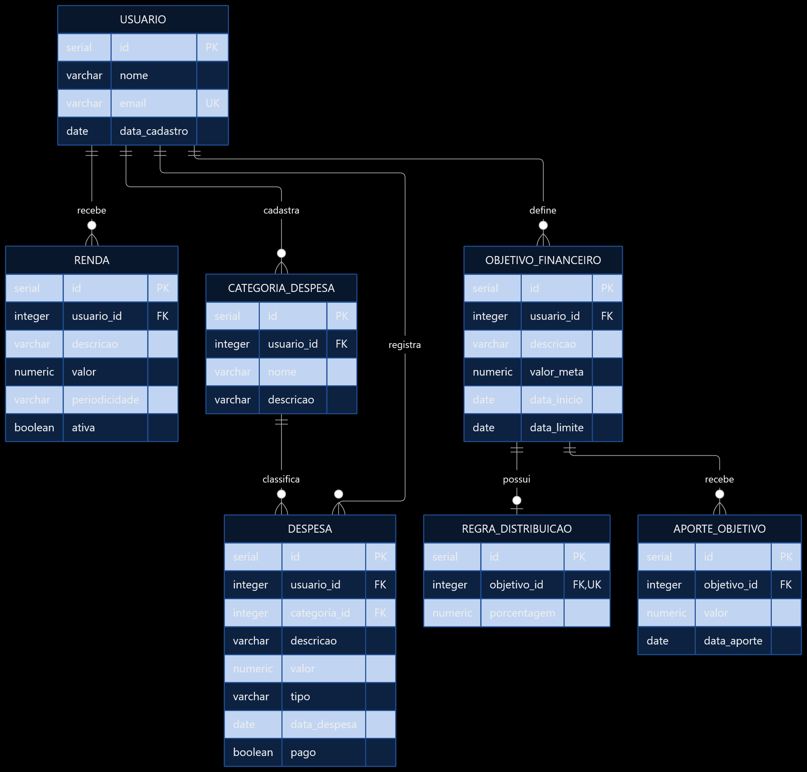
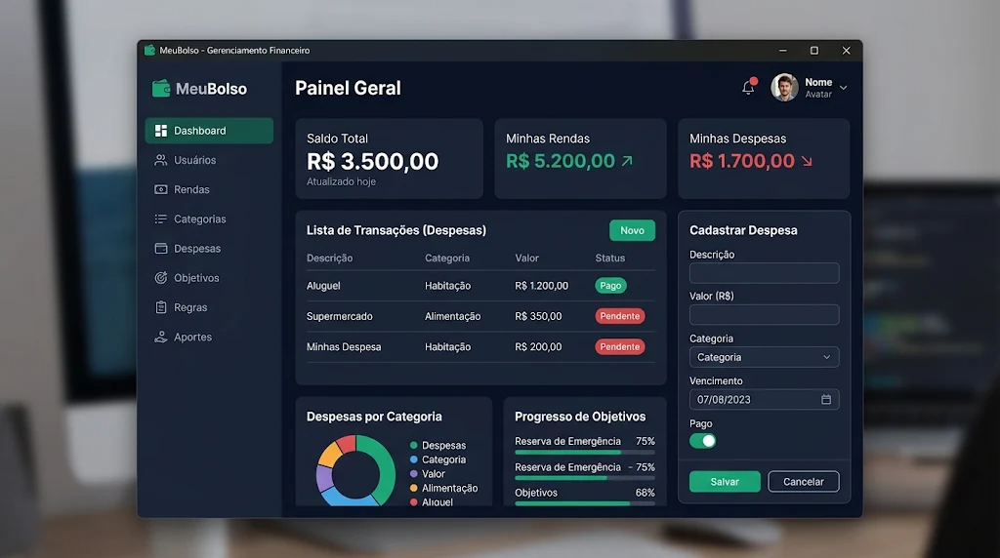

# Sumario
[Parte de Banco de dados](#banco-de-dados)  
[Banco de dados](banco-de-dados) 

Meu projeto é uma controle financeiro.Cujo a ideia segue as ideias a seguir:  

Objetivo:
Fazer uma carteira digital ou apenas um programa. Que pegue ou você forneça, o quanto você ganha em certo espaço de tempo da sua preferência (Diariamente, Semanalmente, Mensalmente) e despesas mensais pra poder dividir e organizar seu dinheiro de acordo com as seus objetivos e perído pra alcança-los  (investimento, viagem, presentear alguém e etc)
Banco de dados: 
porcentagem fixa da divisão de acordo com a quantidade de dinheiro que sobra e tipos diferentes de despesas. Pode envolver uma função pra calcular 
Quanto que ele ganha 
Sua despesa mensal 
divisão das despesas 
Público-alvo:
pessoas que começaram a ter um contato mais recente com dinheiro (jovens )
pessoas com a rotina corrida por causa de conciliação do trabalho com outros ambientes

## banco de dados:



| Entidade A | Cardinalidade | Entidade B | Explicação |
|---|:---:|---|---|
| Usuário | 1:N | Renda | Um usuário pode ter várias fontes de renda. |
| Usuário | 1:N | Categoria de despesa | Um usuário pode criar várias categorias. |
| Categoria de despesa | 1:N | Despesa | Uma categoria pode classificar várias despesas. |
| Usuário | 1:N | Despesa | Um usuário pode registrar várias despesas. |
| Usuário | 1:N | Objetivo financeiro | Um usuário pode criar vários objetivos. |
| Objetivo financeiro | 1:0..1 | Regra de distribuição | Um objetivo pode ter uma regra percentual ou nenhuma. |
| Objetivo financeiro | 1:N | Aporte | Um objetivo pode receber vários aportes. |

## Prototipação do Front-end

### exemplo da tela:


### tipografia: 
Títulos das Seções (Ex: "Painel Geral"):

font-family: 'Inter', sans-serif;

font-size: 24px;

font-weight: 700 (Bold);

color: #FFFFFF;

Subtítulos e Cards (Ex: "Saldo Total", "Minhas Rendas"):

font-size: 14px;

font-weight: 500 (Medium);

color: #94A3B8 (Cinza Azulado);

Valores de Destaque (Ex: "R$ 3.500,00"):

font-size: 28px;

font-weight: 700 (Bold);

color: #FFFFFF ou #10B981 (Verde para positivo) / #EF4444 (Vermelho para despesas).

Textos de Tabelas e Inputs:

font-size: 13px;

font-weight: 400 (Regular);

color: #E2E8F0;

Texto de Navegação (Menu Lateral):

font-size: 14px;

font-weight: 500 (Medium);

2. Paleta de Cores
Fundo do App (Background): #0F172A (Azul bem escuro / Slate 900)

Fundo dos Cards e Modais: #1E293B (Azul escuro / Slate 800)

Barra de Navegação Lateral: #0F172A com separadores sutis em #334155

Destaque / Ação Primária (Verde): #10B981 (Para receitas, botões de salvar e saldos positivos)

Ação Secundária / Alerta (Vermelho): #EF4444 (Para despesas, pendências)

Textos Secundários / Desativados: #64748B ou #94A3B8
```
py
├─ assets
│  ├─ PFront-end.png
│  └─ Tipografia.md
├─ conexao.py
├─ controllers
├─ database
├─ diagramabd.png
├─ main.py
├─ MeuBolsoView.py
├─ models
│  ├─ aporte_objetivo.py
│  ├─ base_model.py
│  ├─ modelo_despesa.py
│  ├─ model_catdespesa.py
│  ├─ model_renda.py
│  ├─ model_usuario.py
│  ├─ modo_de_distribuicao.py
│  ├─ objetivofinanceiro.py
│  └─ __init__.py
├─ PFront-end.png
├─ README.md
├─ schema.sql
└─ views

```